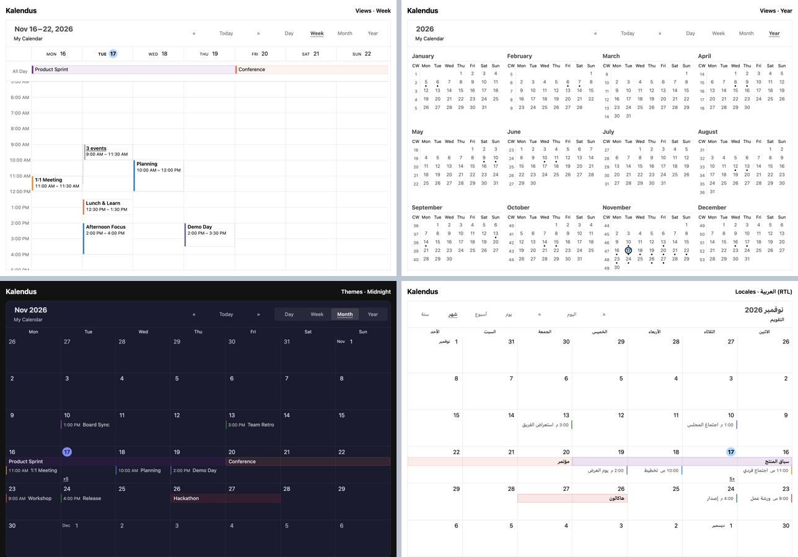

# kalendus

A responsive calendar web component built with Lit 3.x and TypeScript. Multiple view modes, overlapping event handling, per-instance localization, and CSS design tokens.

[](assets/demo.gif)

Select the preview to play the GIF. See overlapping and multi-day events, five themes, German, Japanese, and right-to-left Arabic, plus a Sunday-start calendar. Try the views yourself in [local Storybook](#storybook).

## Installation

Install the published **0.12.0** release:

```bash
bun add @jpahd/kalendus@0.12.0 lit luxon
```

See the [0.12.0 release notes](docs/release-notes.md#0120) for the new opt-in timed edits, time-grid scrolling, and upgrade notes. If you’re staying on 0.11.0, use the [0.11.0 documentation](https://github.com/pders01/kalendus/tree/v0.11.0).

## Quick Usage

Import `@jpahd/kalendus` once in your browser entry point to register the element. This example uses a bundler:

```ts
import '@jpahd/kalendus';
import type { CalendarEntry } from '@jpahd/kalendus';

const date = { day: 17, month: 11, year: 2026 };
const entries: CalendarEntry[] = [
    {
        id: 'studio-check-in',
        kind: 'timed',
        heading: 'Studio check-in',
        date: { start: date, end: date },
        time: { start: { hour: 9, minute: 0 }, end: { hour: 9, minute: 45 } },
    },
];

const calendar = document.createElement('lms-calendar');
calendar.heading = 'My Calendar';
calendar.activeDate = date;
calendar.entries = entries;
document.body.append(calendar);
```

For a page without a bundler, see the [static HTML recipe](docs/integration-guide.md#vanilla-js--html).

In plain JavaScript, assign objects and arrays through `calendar.activeDate` and `calendar.entries`, not HTML attributes. Use the initial and changed `calendar-state-change` snapshots to synchronize fetching. `visibleRange` returns the last committed range after first render; `activeDate` and `viewMode` express the requested navigation. Ranges are half-open civil dates (`start` included, `end` excluded), not timestamps. The exclusive upper bound can be `10000-01-01`. See [Library Usage](docs/library-usage.md).

Each instance auto-detects its locale from `<html lang="...">`. Override per-instance:

```html
<lms-calendar locale="ja" first-day-of-week="0"></lms-calendar>
<lms-calendar locale="es"></lms-calendar>
<lms-calendar locale="zh-Hans"></lms-calendar>
```

## Features

### Multiple View Modes

- **Month View**: Calendar grid with event previews or compact activity indicators; select a date to browse its events
- **Week View**: 7-day view with hourly time slots and condensed windows (e.g., 3-day peeks) driven by CSS tokens
- **Day View**: Single-day view with detailed hourly scheduling
- **Year View**: 12 mini-month grids with density indicators (dot, heatmap, or count) and configurable drill targets for instant navigation

### Advanced Event Handling

- **Readable Density**: Side-by-side time lanes with real-event disclosure when groups cannot fit
- **Duration-Based Positioning**: Events positioned precisely by start time and duration via `LayoutCalculator`
- **Multi-Day Events**: Seamless spanning across multiple days with first/middle/last-day visual styling
- **All-Day Events**: Dedicated all-day section with row allocation via `allDayLayout`
- **Responsive Density**: Automatic layout optimization based on event count and viewport size

### Modern Design

- **Responsive Design**: Mobile-first approach with adaptive layouts and container queries
- **Keyboard & Semantics**: Keyboard date navigation, labeled controls, and focus management; the non-modal detail inspector does not trap focus
- **CSS Custom Properties**: Design tokens for theming

Safari, device, and screen-reader verification remain separate manual checks.

### Per-Instance Localization

- **Independent Locale Per Instance**: Multiple calendars on the same page can each display a different locale
- **28 Listed Locale Codes**: See [Supported Locales](#supported-locales) below; `de-DE` uses the same runtime catalog as `de`
- **Localized UI Strings**: Per-instance catalogs, with explicit English fallback for untranslated phrases
- **Localized Date Formatting**: Weekday names, month names, and date formats use the instance's locale
- **Configurable Week Start**: `firstDayOfWeek` supports any day; the default is always `1` (Monday), not language-derived
- **Locale Readiness**: Await `localeReady`; failed catalog loads expose fallback/error state. Try `retryLocale()`; if the browser cached a failed module request, reload the page.

## Properties

| Property          | Type                            | Default                                   | Description                                                                                   |
| ----------------- | ------------------------------- | ----------------------------------------- | --------------------------------------------------------------------------------------------- |
| `heading`         | `string`                        | `undefined`                               | Calendar title displayed in header                                                            |
| `activeDate`      | `CalendarDate`                  | Current date                              | Displayed date; assigning navigates                                                           |
| `entries`         | `CalendarEntry[]`               | `[]`                                      | Array of calendar events                                                                      |
| `color`           | `string`                        | `'#000000'`                               | Accent color: supported hex, named, rgb/rgba or hsl/hsla formats                              |
| `locale`          | `string`                        | `document.documentElement.lang \|\| 'en'` | Locale for UI strings and date formatting (auto-detected from page, overridable per-instance) |
| `firstDayOfWeek`  | `0-6`                           | `1`                                       | First day of the week (0=Sun, 1=Mon, ..., 6=Sat)                                              |
| `yearDrillTarget` | `'day' \| 'week' \| 'month'`    | `'month'`                                 | View opened by a Year date cell                                                               |
| `yearDensityMode` | `'dot' \| 'heatmap' \| 'count'` | `'dot'`                                   | Chooses how per-day entry density is visualized in year view                                  |
| `dir`             | `'ltr' \| 'rtl' \| 'auto'`      | `'auto'`                                  | Text direction; auto-detected from locale (RTL for `ar`, `he`, etc.)                          |

`viewMode` (`'day' | 'week' | 'month' | 'year'`, default `'month'`; attribute `view-mode`) is also owner-controlled. `visibleRange` is a read-only `{ start, end }` ISO date range including month spillover or the actual condensed-week window.

### Event Structure

```typescript
interface CalendarEntry {
    id?: string; // supply a stable application ID
    kind?: 'all-day' | 'timed'; // explicit semantics preferred
    timeZone?: string; // IANA zone; omit for floating wall-clock times
    heading: string;
    content?: string;
    color?: string; // supported hex, named, rgb/rgba, hsl/hsla
    isContinuation?: boolean; // normally computed by the calendar
    date: {
        start: { day: number; month: number; year: number };
        end: { day: number; month: number; year: number };
    };
    time?: {
        start: { hour: number; minute: number };
        end: { hour: number; minute: number };
    };
}
```

All-day date ends are inclusive and explicit all-day records ignore `time`. Explicit timed entries require `time` and describe one continuous interval with an exclusive end; `24:00` is allowed only as an end boundary. Without `kind`, a reversed daily time window such as `23:00`–`02:00` is rejected before legacy all-day promotion; use explicit `kind: 'timed'` with a later end date for overnight events. Zoned DST gaps and ambiguous endpoints are rejected. Duplicate caller IDs use the first valid record; expansion is limited to the visible range and a segment budget, with `entries-invalid` / `entries-error` diagnostics. See [data contracts](docs/library-usage.md#data-contracts).

Listen on the host for `entry-activate` and `export-entry`. The requests for rendered entries carry the original `{ entry, eventId? }` rather than a day slice. Ordinary entries open the inspector; accordion Agenda rows disclose details inline and export from their own download button. Call `preventDefault()` synchronously to replace those defaults, **not** `stopPropagation()`. Owner calls to `openMenu()` open the inspector without emitting activation. Do not derive fetch ranges from legacy `detail.direction` or `detail.view`. See [Events Reference](docs/events.md).

For timed Day and Week edits, opt in with [`enableEntryInteractions`](docs/events.md#entry-change-requests-opt-in) from `@jpahd/kalendus/entry-interactions`. It emits change proposals; your app decides whether to apply and save them.

### Month Flow and Owner-Supplied Status

**Sizing in 0.12.0:** a definite embed height bounds all four views. Month uses spare height for more previews, then scrolls the grid or selected-date list inside the view. Without a supplied height, Month grows in page flow; Day, Week, and Year use bounded fallbacks. Day and Week fit the full day where space permits, or scroll at a readable scale (`scroll-time-grid` opts into the scrollable detail scale). Year reduces spacing before it scrolls at readable date sizes. In 0.11.0 Month stays in page flow even with a supplied height, and Day and Week use the detail scale. See [Height and Scrolling](docs/layout-and-positioning.md#height-and-scrolling).

Compact Month date selection keeps Month open and shows the selected day's events below the grid. The default wide Month `+N` drills into Day. Use `month-day-behavior="inline"` to keep selection in Month at wide sizes, or `day` for legacy Day drilling with the default `month-presentation="auto"`.

Use `month-agenda-presentation="accordion"` to opt into a dedicated selected-day list within Month, with inline descriptions and `.ics` export. Setting `month-day-behavior="day"` disables the accordion; explicit `month-presentation="presence"` or `month-presentation="previews"` still selects inline. The defaults (`auto`, `full`, `card`) are unchanged. See [presentation choices](docs/library-usage.md#experimental-presentation-choices) for the standard and experimental values.

Set `calendar.loading = true` or `calendar.error = '…'` to distinguish pending/failed data from an empty result. The `status` slot can replace fallback status content. These are owner-controlled presentation inputs, not an automatic fetch implementation; adapters and Expo do not infer them from `entries`.

### Year View Controls

After registering the element as above, use these attributes to open in Year. Assign event data via the element’s `entries` property as in Quick Usage.

```html
<lms-calendar view-mode="year" year-drill-target="day" year-density-mode="heatmap"></lms-calendar>
```

- `year-drill-target` (`day` \| `week` \| `month`): picking a date opens Day, Week, or Month for that date. Month labels always open Month; week numbers always open Week.
- `year-density-mode` (`dot` \| `heatmap` \| `count`): swap between subtle dots, tonal heatmaps, or explicit counts for per-day density.

### Supported Locales

These codes are not a restriction on BCP 47 formatting tags. Historical `de-DE` and regional aliases such as `de-AT` resolve to the `de` runtime catalog. Simplified Chinese aliases resolve to `zh-Hans`; unsupported tags fall back to English. Traditional Chinese does not silently select Simplified Chinese. The recommendations below do not change the Monday default. Translation maintenance uses canonical JSON catalogs; see [locale workflow](https://github.com/pders01/kalendus/blob/main/src/locales/README.md).

<!-- GENERATED:LOCALE_TABLE:START -->

| Code      | Language           | Recommended Week Start |
| --------- | ------------------ | ---------------------- |
| `en`      | English            | Sunday                 |
| `ar`      | Arabic             | Saturday               |
| `bn`      | Bangla             | Sunday                 |
| `cs`      | Czech              | Monday                 |
| `da`      | Danish             | Monday                 |
| `de`      | German             | Monday                 |
| `de-DE`   | German (Germany)   | Monday                 |
| `el`      | Greek              | Monday                 |
| `es`      | Spanish            | Monday                 |
| `fi`      | Finnish            | Monday                 |
| `fr`      | French             | Monday                 |
| `he`      | Hebrew             | Sunday                 |
| `hi`      | Hindi              | Sunday                 |
| `id`      | Indonesian         | Sunday                 |
| `it`      | Italian            | Monday                 |
| `ja`      | Japanese           | Sunday                 |
| `ko`      | Korean             | Sunday                 |
| `nb`      | Norwegian Bokmål   | Monday                 |
| `nl`      | Dutch              | Monday                 |
| `pl`      | Polish             | Monday                 |
| `pt`      | Portuguese         | Sunday                 |
| `ru`      | Russian            | Monday                 |
| `sv`      | Swedish            | Monday                 |
| `th`      | Thai               | Sunday                 |
| `tr`      | Turkish            | Monday                 |
| `uk`      | Ukrainian          | Monday                 |
| `vi`      | Vietnamese         | Monday                 |
| `zh-Hans` | Simplified Chinese | Sunday                 |

<!-- GENERATED:LOCALE_TABLE:END -->

## Styling & Theming

Kalendus has a **neutral base style** that follows the embedding page’s color scheme. Choose one built-in theme for an opinionated look:

```js
import '@jpahd/kalendus/themes/default.css'; // or choose ink, soft, brutalist, or midnight
```

For example, customize the neutral base while keeping its scheme-aware foreground and background:

```css
lms-calendar {
    color: CanvasText;
    --primary-color: #1976d2;
    --background-color: Canvas;
    --entry-border-radius: 6px;
}
```

See [Theming Reference](docs/theming.md) for all 5 built-in themes, color format support, and quick-start examples. For supported overrides, see the [CSS Token Reference](docs/css-tokens.md).

## Documentation Map

| Audience               | Document                                                                             | Highlights                                                                 |
| ---------------------- | ------------------------------------------------------------------------------------ | -------------------------------------------------------------------------- |
| Upgrading              | [Release Notes](docs/release-notes.md)                                               | 0.12.0 changes and upgrade notes                                           |
| Integrators            | [Integration Guide](docs/integration-guide.md)                                       | Framework recipes, theming tokens, analytics hooks                         |
| Application Developers | [Library Usage](docs/library-usage.md)                                               | API surface, data contracts, DOM events                                    |
| CSS / Design Systems   | [CSS Token Reference](docs/css-tokens.md)                                            | CSS custom properties by category                                          |
| CSS / Design Systems   | [Theming Reference](docs/theming.md)                                                 | Built-in themes, color formats, quick-start examples                       |
| Events                 | [Events Reference](docs/events.md)                                                   | State snapshots, cancelable requests, diagnostics and legacy notifications |
| Layout                 | [Layout & Positioning](docs/layout-and-positioning.md)                               | Height requirements, responsive behavior, all-day events                   |
| Troubleshooting        | [Troubleshooting](docs/troubleshooting.md)                                           | Top consumer issues and fixes                                              |
| Component Contributors | [Developer Guide](docs/developer-guide.md)                                           | Internal architecture, debugging tips, adding locales                      |
| Rendering Internals    | [Rendering Pipeline](docs/rendering-pipeline.md)                                     | Segment preparation, time-grid layout, condensed weeks and density         |
| Architecture           | [Architecture Overview](docs/architecture.md)                                        | Component tree, technologies, design patterns                              |
| Design Tokens          | [Design Token Refactoring](docs/design-token-refactoring.md)                         | Historical: token audit and proposed hierarchy                             |
| Backend/API            | [API Server Guide](docs/api-server.md)                                               | Source/local-tarball REST + SSE backend and adapters                       |
| Expo / React Native    | [Native Bridge](https://github.com/pders01/kalendus/blob/main/expo-bridge/README.md) | Source bridge, self-contained build and separate native verification       |

## Testing

```bash
bun run test                 # Mocha unit tests
bun run test:watch
bun run test:components      # Web Test Runner + Playwright
bun run test-storybook       # Storybook interactions (Vitest)
bun run test:release         # Full release gates (all three browser engines by default)
```

See the [release checklist](docs/developer-guide.md#release-checklist) for browser setup, package checks, and manual acceptance.

### Test Categories

- **Unit tests** (`test/unit/lib/`): Pure function tests with Mocha + Chai
- **Component tests** (`test/unit/components/`): Lit component tests with @open-wc/testing
- **Interaction tests**: Storybook stories with `play` functions, run via `@storybook/addon-vitest`

## Storybook

Explore all features and variations in Storybook:

```bash
bun run storybook
```

### Where to start

- **Visual review → Library scenarios → Library: Month → Agenda → Week**: Select Nov 17, open an event and download its `.ics`, then switch to Week to compare times. This story opts into the Agenda accordion.
- **Visual review → Viewport matrix → Matrix**: Open a cell for a live Day, Week, Month, Agenda, or Year story. Controls are on the live stories, not on Matrix. Vary event density, text size, and locale there. As a navigation check, open **Large text + RTL → Week** and confirm the 320 × 740 preset, Arabic locale, and 24px text setting. Presets describe CSS dimensions for the preview frame. The calendar embed subtracts 16px of padding on each edge and may make a smaller preview frame scroll. Neither size emulates a physical device.
- **Components → Kalendus → Overview**: Choose **Default** for the neutral component, **Default Theme** for the opt-in stylesheet, or **Mobile View** for the 375 × 667 CSS-pixel preview preset.
- **Components → Kalendus → Layout → Condensed Week (Up to 3 Days)**: Starts in Week with up to three days. The calendar shows fewer when the embed cannot fit three readable columns.

The sidebar also includes the other built-in themes, locale and RTL examples, Year drill-down, and stress tests. See [Review calendar layouts](docs/developer-guide.md#review-calendar-layouts) for the automated journeys and capture commands.

## Development

```bash
bun install
bun run storybook            # Start Storybook dev server
bun run build                # Vite bundle + declarations
bun run test                 # Mocha tests
bun run lint                 # lit-analyzer + oxlint
bun run format               # Format with oxfmt
bun run demo:gif             # Regenerate the README GIF and preview (requires ffmpeg and Playwright Chromium)
bun scripts/check-locales.mjs --write # Regenerate from canonical JSON catalogs
bun run i18n:check           # Check completeness, preservation and roundtrip
bun run docs:sync:check      # Check generated documentation sections
bun run docs:build           # Build the docs site and check internal links
```

Do not translate generated TypeScript/XLIFF or run extraction as the translation source workflow. Edit the canonical catalogs described in [the canonical locale guide](https://github.com/pders01/kalendus/blob/main/src/locales/README.md).

See `docs/developer-guide.md` for internal architecture notes, troubleshooting checklists, and tips on extending condensed week layouts or localization.

### API Server (optional)

The repository includes `@jpahd/kalendus-server`, a Hono + SQLite backend with REST/SSE endpoints. It is available from the source workspace or a locally built tarball, **not** the public registry.

The server is **private-deny by default**: inject a host `authorize` policy for every calendar route. CORS uses exact allowed origins and is not authorization. For a deliberately unauthenticated demo, follow the [loopback demo using a fresh database](docs/api-server.md#local-demo-and-build). [server/README.md](https://github.com/pders01/kalendus/blob/main/server/README.md) is the authoritative API, authorization, CORS, range-limit, and deployment guide.

### Expo / React Native (optional)

The [source bridge guide](https://github.com/pders01/kalendus/blob/main/expo-bridge/README.md) covers `bun run build:iife`, self-contained inline document generation, `bun scripts/check-bridge.mjs`, and the separate Expo app typecheck/device gates. The source revision for 0.12.0 uses protocol v2; update the copied wrapper and regenerate the shell together from the same revision. The development shell is not a standalone Metro asset. Browser checks do not establish native-device or screen-reader compatibility.

## License

MIT License - see LICENSE file for details.
