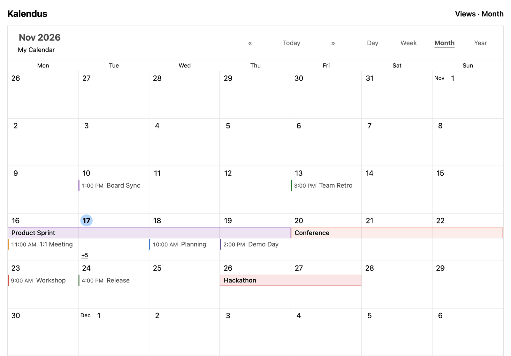

# kalendus

A responsive calendar web component built with Lit 3.x and TypeScript. Multiple view modes, overlapping event handling, per-instance localization, and CSS design tokens.



## Installation

```bash
bun add @jpahd/kalendus lit luxon
```

## Quick Usage

Import `@jpahd/kalendus` once to register the element. In a Lit template:

```ts
html`<lms-calendar
    heading="My Calendar"
    .activeDate=${{ day: 15, month: 3, year: 2026 }}
    view-mode="month"
    .entries=${myEvents}
    color="#1976d2"
    style="height: 600px"
></lms-calendar>`;
```

In plain JavaScript, assign objects and arrays through `calendar.activeDate` and `calendar.entries`, not HTML attributes. `activeDate` and `viewMode` are public owner controls; read `visibleRange` or listen for the initial and changed `calendar-state-change` snapshots to synchronize fetching. Ranges are half-open ISO civil dates (`start` included, `end` excluded), not timestamps. See [Library Usage](docs/library-usage.md).

Each instance auto-detects its locale from `<html lang="...">`. Override per-instance:

```html
<lms-calendar locale="ja" first-day-of-week="0"></lms-calendar>
<lms-calendar locale="es"></lms-calendar>
<lms-calendar locale="zh-Hans"></lms-calendar>
```

## Features

### Multiple View Modes

- **Month View**: Traditional monthly calendar with color-coded event indicators
- **Week View**: 7-day view with hourly time slots and condensed windows (e.g., 3-day peeks) driven by CSS tokens
- **Day View**: Single-day view with detailed hourly scheduling
- **Year View**: 12 mini-month grids with density indicators (dot, heatmap, or count) and configurable drill targets for instant navigation

### Advanced Event Handling

- **Smart Overlapping**: Cascading layout with progressive transparency preserves event visibility
- **Duration-Based Positioning**: Events positioned precisely by start time and duration via `LayoutCalculator`
- **Multi-Day Events**: Seamless spanning across multiple days with first/middle/last-day visual styling
- **All-Day Events**: Dedicated all-day section with row allocation via `allDayLayout`
- **Responsive Density**: Automatic layout optimization based on event count and viewport size

### Modern Design

- **Responsive Design**: Mobile-first approach with adaptive layouts and container queries
- **Color Dot Indicators**: Scalable month view with color-coded event dots
- **Keyboard & Semantics**: Keyboard date navigation, labeled controls, and focus management; the non-modal detail inspector does not trap focus
- **CSS Custom Properties**: Design tokens for theming

Safari, device, and screen-reader verification remain separate manual checks.

### Per-Instance Localization

- **Independent Locale Per Instance**: Multiple calendars on the same page can each display a different locale
- **28 Built-in Locales**: See [Supported Locales](#supported-locales) below for the full list
- **Localized UI Strings**: Per-instance catalogs, with explicit English fallback for untranslated phrases
- **Localized Date Formatting**: Weekday names, month names, and date formats use the instance's locale
- **Configurable Week Start**: `firstDayOfWeek` supports any day; the default is always `1` (Monday), not language-derived
- **Locale Readiness**: Await `localeReady`; failed catalog loads expose fallback/error state and can be retried with `retryLocale()`

## Properties

| Property          | Type                            | Default                                   | Description                                                                                   |
| ----------------- | ------------------------------- | ----------------------------------------- | --------------------------------------------------------------------------------------------- |
| `heading`         | `string`                        | `undefined`                               | Calendar title displayed in header                                                            |
| `activeDate`      | `CalendarDate`                  | Current date                              | Displayed date; assigning navigates                                                           |
| `entries`         | `CalendarEntry[]`               | `[]`                                      | Array of calendar events                                                                      |
| `color`           | `string`                        | `'#000000'`                               | Accent color: supported hex, named, rgb/rgba or hsl/hsla formats                              |
| `locale`          | `string`                        | `document.documentElement.lang \|\| 'en'` | Locale for UI strings and date formatting (auto-detected from page, overridable per-instance) |
| `firstDayOfWeek`  | `0-6`                           | `1`                                       | First day of the week (0=Sun, 1=Mon, ..., 6=Sat)                                              |
| `yearDrillTarget` | `'day' \| 'month'`              | `'month'`                                 | Determines whether a year-view click opens day or month view                                  |
| `yearDensityMode` | `'dot' \| 'heatmap' \| 'count'` | `'dot'`                                   | Chooses how per-day entry density is visualized in year view                                  |
| `dir`             | `'ltr' \| 'rtl' \| 'auto'`      | `'auto'`                                  | Text direction; auto-detected from locale (RTL for `ar`, `he`, etc.)                          |

`viewMode` (`'day' | 'week' | 'month' | 'year'`, default `'month'`; attribute `view-mode`) is also owner-controlled. `visibleRange` is a read-only `{ start, end }` ISO date range including month spillover or the actual condensed-week window.

### Event Structure

```typescript
interface CalendarEntry {
    id?: string; // supply a stable application ID
    kind?: 'all-day' | 'timed'; // explicit semantics preferred
    timeZone?: string; // IANA zone; omit for floating wall-clock times
    heading: string;
    content?: string;
    color?: string; // supported hex, named, rgb/rgba, hsl/hsla
    isContinuation?: boolean; // normally computed by the calendar
    date: {
        start: { day: number; month: number; year: number };
        end: { day: number; month: number; year: number };
    };
    time?: {
        start: { hour: number; minute: number };
        end: { hour: number; minute: number };
    };
}
```

All-day date ends are inclusive. Explicit timed entries require `time` and describe one continuous interval with an exclusive end; `24:00` is allowed only as an end boundary. Without `kind`, legacy inclusive dates/daily windows and multi-day all-day promotion remain compatible. Zoned DST gaps and ambiguous endpoints are rejected. Duplicate caller IDs use the first valid record; expansion is limited to the visible range and a segment budget, with `entries-invalid` / `entries-error` diagnostics. See [data contracts](docs/library-usage.md#data-contracts).

`entry-activate` and `export-entry` are cancelable requests carrying the canonical original `{ entry, eventId }`. Call `preventDefault()` synchronously to replace the inspector or download, **not** `stopPropagation()`. Legacy action notifications remain available; do not derive fetch ranges from their `detail.direction` or `detail.view`. See [Events Reference](docs/events.md).

### Year View Controls

```html
<lms-calendar
    year-drill-target="day"
    year-density-mode="heatmap"
    .entries="${events}"
></lms-calendar>
```

- `year-drill-target` (`day` \| `month`): picking a day can either open the specific day or simply focus its month.
- `year-density-mode` (`dot` \| `heatmap` \| `count`): swap between subtle dots, tonal heatmaps, or explicit counts for per-day density.

### Supported Locales

These are catalog codes, not a restriction on BCP 47 formatting tags. Regional aliases (for example `de-AT` → `de`) and Simplified Chinese aliases resolve to a catalog; unsupported tags fall back to English. Traditional Chinese does not silently select Simplified Chinese. The recommendations below do not change the Monday default. Translation maintenance uses canonical JSON catalogs; see [locale workflow](src/locales/README.md).

<!-- GENERATED:LOCALE_TABLE:START -->

| Code      | Language           | Recommended Week Start |
| --------- | ------------------ | ---------------------- |
| `en`      | English            | Sunday                 |
| `ar`      | Arabic             | Saturday               |
| `bn`      | Bangla             | Sunday                 |
| `cs`      | Czech              | Monday                 |
| `da`      | Danish             | Monday                 |
| `de`      | German             | Monday                 |
| `de-DE`   | German (Germany)   | Monday                 |
| `el`      | Greek              | Monday                 |
| `es`      | Spanish            | Monday                 |
| `fi`      | Finnish            | Monday                 |
| `fr`      | French             | Monday                 |
| `he`      | Hebrew             | Sunday                 |
| `hi`      | Hindi              | Sunday                 |
| `id`      | Indonesian         | Sunday                 |
| `it`      | Italian            | Monday                 |
| `ja`      | Japanese           | Sunday                 |
| `ko`      | Korean             | Sunday                 |
| `nb`      | Norwegian Bokmål   | Monday                 |
| `nl`      | Dutch              | Monday                 |
| `pl`      | Polish             | Monday                 |
| `pt`      | Portuguese         | Sunday                 |
| `ru`      | Russian            | Monday                 |
| `sv`      | Swedish            | Monday                 |
| `th`      | Thai               | Sunday                 |
| `tr`      | Turkish            | Monday                 |
| `uk`      | Ukrainian          | Monday                 |
| `vi`      | Vietnamese         | Monday                 |
| `zh-Hans` | Simplified Chinese | Sunday                 |

<!-- GENERATED:LOCALE_TABLE:END -->

## Styling & Theming

Kalendus ships **unstyled by default** (neutral base, respects OS light/dark mode). Import a built-in theme for an opinionated look:

```js
import '@jpahd/kalendus/themes/default.css'; // polished light theme
import '@jpahd/kalendus/themes/ink.css'; // monochrome editorial
import '@jpahd/kalendus/themes/soft.css'; // pastel, generous radii
import '@jpahd/kalendus/themes/brutalist.css'; // bold borders, stark contrast
import '@jpahd/kalendus/themes/midnight.css'; // dark mode
```

Override individual CSS custom properties to fine-tune any theme:

```css
lms-calendar {
    --primary-color: #1976d2;
    --background-color: #ffffff;
    --entry-border-radius: 6px;
}
```

See [Theming Reference](docs/theming.md) for all 5 built-in themes, color format support, and quick-start examples. For the complete token list, see the [CSS Token Reference](docs/css-tokens.md).

## Documentation Map

| Audience               | Document                                                     | Highlights                                                                 |
| ---------------------- | ------------------------------------------------------------ | -------------------------------------------------------------------------- |
| Integrators            | [Integration Guide](docs/integration-guide.md)               | Framework recipes, theming tokens, analytics hooks                         |
| Application Developers | [Library Usage](docs/library-usage.md)                       | API surface, data contracts, DOM events                                    |
| CSS / Design Systems   | [CSS Token Reference](docs/css-tokens.md)                    | CSS custom properties by category                                          |
| CSS / Design Systems   | [Theming Reference](docs/theming.md)                         | Built-in themes, color formats, quick-start examples                       |
| Events                 | [Events Reference](docs/events.md)                           | State snapshots, cancelable requests, diagnostics and legacy notifications |
| Layout                 | [Layout & Positioning](docs/layout-and-positioning.md)       | Height requirements, responsive behavior, all-day events                   |
| Troubleshooting        | [Troubleshooting](docs/troubleshooting.md)                   | Top consumer issues and fixes                                              |
| Component Contributors | [Developer Guide](docs/developer-guide.md)                   | Internal architecture, debugging tips, adding locales                      |
| Rendering Internals    | [Rendering Calculations](docs/rendering-calculations.md)     | Grid math, condensed weeks, density modes                                  |
| Architecture           | [Architecture Overview](docs/architecture.md)                | Component tree, technologies, design patterns                              |
| Design Tokens          | [Design Token Refactoring](docs/design-token-refactoring.md) | Historical: token audit and proposed hierarchy                             |
| Backend/API            | [API Server Guide](docs/api-server.md)                       | Private-by-default REST + SSE backend and adapters                         |
| Expo / React Native    | [Native Bridge](expo-bridge/README.md)                       | Self-contained build, public events and native verification gates          |

## Testing

```bash
bun run test                 # Mocha unit tests
bun run test:watch
bun run test:components      # Web Test Runner + Playwright
bun run test-storybook       # Storybook interactions (Vitest)
```

### Test Categories

- **Unit tests** (`test/unit/lib/`): Pure function tests with Mocha + Chai
- **Component tests** (`test/unit/components/`): Lit component tests with @open-wc/testing
- **Interaction tests**: Storybook stories with `play` functions, run via `@storybook/addon-vitest`

## Storybook

Explore all features and variations in Storybook:

```bash
bun run storybook
```

### Available Stories

- **Default**: Basic calendar with sample events
- **Theme stories**: Default, Ink, Soft, Brutalist, Midnight — one story per built-in theme
- **Custom Theming**: Inline CSS variable overrides
- **Locale stories**: Individual stories for each supported locale (German, French, Spanish, Japanese, etc.)
- **LocaleShowcase**: Multiple calendars on one page, each with a different locale
- **WeekStartComparison**: Side-by-side Monday-first vs Sunday-first
- **Heavy Event Load**: Stress testing with 200+ events
- **Overlapping Events**: Extreme overlap scenarios
- **Tall Container**: Verifies layout in oversized containers
- **RTLShowcase**: Side-by-side Arabic and Hebrew calendars with automatic RTL layout
- **RTLOverride**: Demonstrates explicit `dir="ltr"` override on an RTL locale
- **Mobile View**: Responsive mobile experience

## Development

```bash
bun install
bun run storybook            # Start Storybook dev server
bun run build                # Vite bundle + declarations
bun run test                 # Mocha tests
bun run lint                 # lit-analyzer + oxlint
bun run format               # Format with oxfmt
bun run demo:gif             # Record demo GIF (requires ffmpeg)
bun scripts/check-locales.mjs --write # Regenerate from canonical JSON catalogs
bun run i18n:check           # Check completeness, preservation and roundtrip
bun run docs:sync:check      # Check generated documentation sections
```

Do not translate generated TypeScript/XLIFF or run extraction as the translation source workflow. Edit the canonical catalogs described in [src/locales/README.md](src/locales/README.md).

See `docs/developer-guide.md` for internal architecture notes, troubleshooting checklists, and tips on extending condensed week layouts or localization.

### API Server (optional)

The repository includes `@jpahd/kalendus-server`, a Hono + SQLite backend with REST/SSE endpoints.

The server is **private-deny by default**: inject a host `authorize` policy for every calendar route. CORS uses exact allowed origins and is not authorization. Only an explicitly public local demo should use:

```bash
cd server
bun run db:migrate
bun run db:seed # optional demo data
KALENDUS_PUBLIC_DEMO=true bun run dev
```

[server/README.md](server/README.md) is the authoritative API, authorization, CORS, range-limit and deployment guide; [API Server Guide](docs/api-server.md) provides an overview.

### Expo / React Native (optional)

The [source bridge guide](expo-bridge/README.md) covers `bun run build:iife`, self-contained inline document generation, `bun scripts/check-bridge.mjs`, and the separate Expo app typecheck/device gates. The development shell is not a standalone Metro asset. Browser checks do not establish native-device or screen-reader compatibility.

## License

MIT License - see LICENSE file for details.
